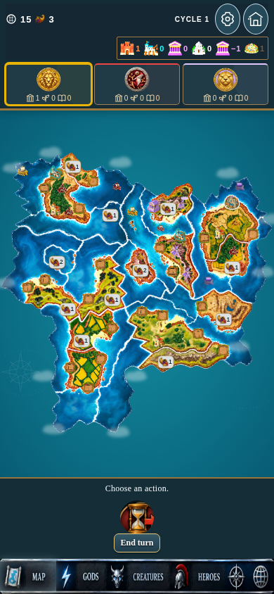
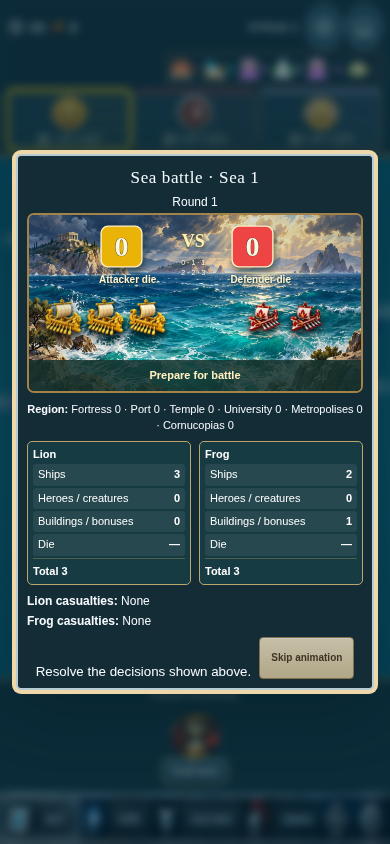

# Cyclades 18.0 Preview

New three-player map, permanent churches, supplied god/building/faction graphics, image ships, optional edge clouds, and battle/touch/interface fixes.

## Download and install

1. Open [Cyclades-v18.0-preview.apk](Cyclades-v18.0-preview.apk).
2. Tap **Download raw file** or the downward arrow on the file page.
3. Open the downloaded APK on Android to update **Cyclades Preview**.

This updates the existing locally signed Preview app. The original Cyclades app stays separate. Export your saved campaign before updating. New three-player campaigns use the replacement map; existing campaigns retain their original board.

[Complete source ZIP](Cyclades-v18.0-full-source.zip) · [Full changes](CHANGES.md) · [Validation report](validation-summary-v18.0.json) · [Checksums](downloads-v18.0.json)

The red faction is now Frog, using the supplied red/cream warrior, emblem and directional ships. Lion ships have cream sails. Ox/Otter/Lion troops and the supplied god/building graphics are included. Church icons appear only as permanent map landmarks, not construction options or top counters. Clouds default off in Settings and stop drifting under Reduced Motion. Troops have no stationary idle animation.

All 58 production browser tests pass. APK signatures/alignment and all 452 packaged web assets were verified. Seven source-provided suites pass; two inherited rules/harness discrepancies are documented. Physical Android testing has not been performed.

The newer Medusa replacement was absent from the supplied ZIPs, so its previous artwork is retained. Zeus deck ordering is tested; no additional timing change was made without a reproducible example. Randomized-god setup remains deferred.

