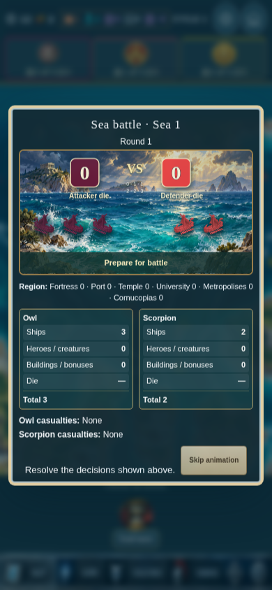

# Cyclades 17.1 Preview

Battle and interface fixes, compact shops/navigation, demolition animation, and improved maroon/light-cream Owl artwork.

## Download

1. Open [Cyclades-v17.1-preview.apk](Cyclades-v17.1-preview.apk).
2. Tap **Download raw file** or the downward arrow.
3. Open the downloaded APK on Android to update **Cyclades Preview**.

The original Cyclades installation remains separate. Export saves before changing installations.

[Complete source ZIP](Cyclades-v17.1-full-source.zip) · [Changes and pending work](CHANGES.md) · [Validation](validation-summary-v17.1.json) · [Checksums](downloads-v17.1.json)

All 51 browser checks pass. APK signatures, alignment and all 410 bundled web assets verified. Physical Android testing has not been performed. Two inherited source-suite discrepancies remain documented.

Zeus deck-order tests pass. Clarification is still needed about the reported timing/order issue. The separately supplied replacement map, cloud effects, image ships and other new portraits are not part of this patch.

