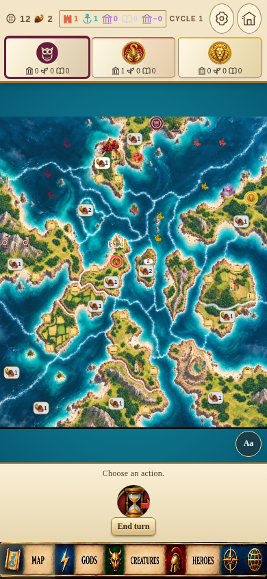

# Cyclades 17.0 Preview

New three-player map, supplied building/navigation artwork, maroon Owl faction, experimental 3D ships with sailing audio, hero touch fixes and the approved controls/readability/battle improvements.

## Download on your phone or computer

1. Open [Cyclades-v17.0-preview.apk](Cyclades-v17.0-preview.apk).
2. Tap **Download raw file**, or the downward arrow on the file page.
3. Open the downloaded APK on Android to install **Cyclades Preview**.

The APK updates the existing locally signed Cyclades Preview. The original Cyclades app remains separate. Export your saved game before changing installations. New three-player campaigns use the supplied map; existing saves retain their original board.

Download [the complete source ZIP](Cyclades-v17.0-full-source.zip) with the same downward-arrow button. It includes the graphics assets, original ship STL, Android project, build scripts, tests and map-authoring data. Signing keys are excluded.

## What changed

- Continuous three-player map: 14 land areas, 14 sea areas, 24 building sites, three churches, ten single and two double offering locations.
- All faction fleets use the supplied 3D ship, with slow bobbing, sailing/wakes and water audio following the existing sound controls.
- Maroon Owl faction, ownership rings, supplied buildings and normal/dark navigation artwork with a selected-button glow.
- Rectangular Back/Confirm controls; gray printed offering plaques turn white when extra offerings are added.
- Hero popup fixes, clearer unavailable actions and battles, piece-size controls and graphics-quality settings. Shops shuffle only for a new campaign and keep saved deck order.
- Randomized gods remain deferred as agreed.

See [full changes and limits](CHANGES.md), [screenshots](screenshots), [validation report](validation-summary-v17.0.json) and [download checksums](downloads-v17.0.json).

All 47 production browser checks pass. Seven source-provided suites pass; two inherited rules/harness discrepancies remain documented. APK signatures, alignment and all 410 packaged web assets were verified. Physical Android performance, battery use and device WebGL behavior still need testing.

